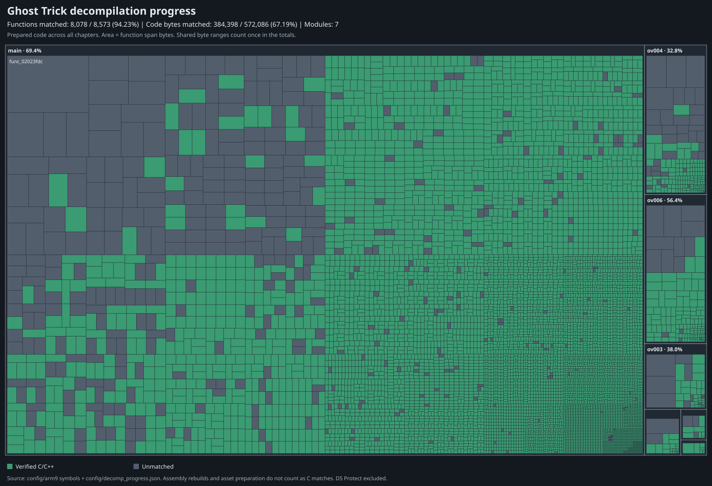

# Ghost Trick Vita

A PS Vita port using the original DS game logic and a single-screen interface, drawn with either the 2023 remaster's art or the DS cartridge's own.

## Where the port stands

The whole game is routed and plays from start to finish. An automatic playthrough of 1719 route steps follows a reference playthrough from the opening of Chapter 1 to the closing credits and back to the title screen, replayed on a computer through the same input code the Vita uses. It finishes with no step failed, no scene skipped and no stand-in for the game's own logic; one step the route passes over is left out of the count.

The same playthrough has run on a real Vita. On 2026-11-13 the debug build played the route by itself, at up to 30 ticks a frame, and did all 1718 steps in about 53 minutes. It saved every chapter from 2 to 18 on the way and had no softlock and no crash. The title screen had not appeared in the log when the run was stopped, 47 seconds after the last step. The port now boots into a title screen and returns to it at the story's end, so far checked on the Mac only. What is left is the script opcodes that still log as not ported (16 were met on that run) and a few slow stretches where large textures load.

The app installs and runs from locally converted art: the remaster's, the DS cartridge's, or both. The one-command setup below prepares the whole game.

## Legal disclaimer

This is an unofficial fan project, not affiliated with or endorsed by Capcom, Nintendo or Sony. _Ghost Trick_ belongs to Capcom, and all trademarks belong to their owners.

This repository contains only original work. It contains **no ROM files and no extracted Nintendo or Capcom assets**: no game art, music, sound, text, fonts or script data. Two things in it are worth knowing about:

- `src/` holds C/C++ reconstructed from a study of the DS game's compiled code, along with the symbol and layout data in `config/`. It is not the game's original source code.
- `srcVita/src/third_party/stb_vorbis.c` is an open-source library by its own author, under its own license.

**You must source these files yourself**, from your own legally obtained copy of the game. This project does not provide them or say where to get them. Please don't post game files, or links to them, in this repository.

## Decompilation progress

[](https://liambsulliva.github.io/ghost-trick-vita/)

Each rectangle is one function, sized by its byte span and grouped by module. Green means reconstructed C/C++ passes the compiler and linked-function byte check; gray means unmatched. Full-game C link integration and Vita execution are separate milestones.

Click the preview to open the [interactive treemap](https://liambsulliva.github.io/ghost-trick-vita/), then click a green rectangle to open its verified C/C++ source on GitHub. Gray rectangles have no verified source yet. The README image itself is static; the viewer provides the function links. See [the viewer setup](docs/progress-viewer.md).

[The decompilation's README](src/README.md) explains what the chart counts, how to regenerate it and how a function is verified.

## Run it on a Vita

The VPK holds only the app. It has no game data in it, so it also needs art, sound and text converted from your own copies of the game. The app plays the game from the DS game's own scripts, with its music, sounds, narration and dialogue. Your DS cartridge dump alone is enough: it gives the DS set, drawn with the cartridge's own art, text and sound. Adding your copy of the remaster's Android release also gives the remastered set. [The app's README](srcVita/README.md#controls) lists the buttons.

You need:

- Python 3, `make`, `clang` and ImageMagick 7 (the `magick` command). The converter draws the game's text with `magick`, which needs FreeType support: `magick -list format | grep OTF` should print a line.
- About 3.6 GB of free disk space for the game files and the converted game.
- Your own dump of the USA DS cartridge. Your own copy of the remaster's Android release is optional: without it the port uses the cartridge's own art, text and sound only.
- VitaSDK, to build the VPK. [The app's README](srcVita/README.md#build-and-test) lists its libraries.
- A Vita that can install homebrew with VitaShell.
- The Vita's shader compiler at `ur0:data/libshacccg.suprx`. It does not come with the VPK. Extract it once with ShaRKF00D, if another app has not already made you do this.

The converter steps have been run on macOS only. This project's own testing installs with Vita Companion, so the VitaShell install and FTP copy below are the usual routes, but they have not been tried with this build.

Run every command below from the top of this repository.

### Set everything up with one command

`srcVita/tools/set_up_game.py` does the whole preparation in one go. Give it your own dump of the USA DS cartridge (game code `BGTE`) and, for the remastered art, your copy of the Android package:

```bash
python3 -I srcVita/tools/set_up_game.py --apk "path/to/your-copy.apk" --ds-rom "path/to/your-cartridge.nds"
```

It prints each stage as it starts, with a progress bar while it copies the game files and a running timer with the latest output for the rest:

1. **Check the tools.** `make`, `clang` and `magick` with FreeType support.
2. **Copy the game files out of the Android package.** It takes `re_chunk_000.pak`, `data01` and `data02` (about 3.1 GB) from the package's `assets/` folder into `extracted/remaster_apk/`. They were only tested with Android v1.0.0, packaged as one APK with all three files.
3. **Find the text key.** The narration and speech bubbles are stored encrypted. The key is not in this repository, so it is found in your own package, saved as `extracted/remaster_apk/text_key.bin` and never printed.
4. **Build the converter.**
5. **Convert the art, sound, text and DS scripts.** The cartridge's own set goes into `extracted/vita_assets/game_ds/`, and with the Android package the remastered set goes into `extracted/vita_assets/game/` (about 3.3 GB). The app plays the game from the DS game's own scripts, so the cartridge dump is required. A cartridge from another region is refused, because no other region's scripts have been checked. [The asset format](srcVita/docs/asset_format.md#two-art-sets) explains the two sets.
6. **Plan the loading.** It replays the game on this computer and writes, for each scene, the list of textures to read ahead and one bundle of its animations.
7. **Build the package**, if VitaSDK is installed. [The app's README](srcVita/README.md#build-and-test) lists its libraries.
8. **Copy everything to the Vita.** The script tells you what to install and copy, which the next section explains.

Running it again skips what is already done and converts only what changed, so it is also how you update after pulling this repository. Stages 2 and 3 are skipped once their files are in place, so `--apk` is only needed the first time. If a stage fails, the script stops and shows the last lines that stage printed.

Everything under `extracted/` is ignored by git. `tools/rom_audit.py` refuses a file named `text_key.bin` and, when your key file is in place, any file git would track that holds the key as raw bytes, hex or decimal text.

### Copy everything to the Vita

Install `srcVita/build/ghosttrick.vpk` with VitaShell from anywhere under `ux0:`, then copy what is inside `extracted/vita_assets/game_ds/` to `ux0:data/ghosttrick/assets_ds/` and, if you built it, what is inside `extracted/vita_assets/game/` to `ux0:data/ghosttrick/assets/`. Copy each folder's contents, not the folder itself: a path like `ux0:data/ghosttrick/assets/game/manifest.txt` will not be found. With both sets installed, Options' Visual Filter picks one; with one, that one runs.

To copy by hand, put the Vita and this computer on the same Wi-Fi network. In VitaShell, press SELECT to start its FTP server. If SELECT starts USB instead, press START and set **SELECT button** to **FTP**. Then connect an FTP client to the address VitaShell shows.

### Check that it worked

Launch the app. If it was already open, quit it with START first, because it reads the files only when it starts. A Now Loading screen with a red bar shows while the scripts and art load, then the opening plays.

If you see something else:

| What you see                                                    | What is wrong                                                    | Look in the log for                      |
| --------------------------------------------------------------- | ---------------------------------------------------------------- | ---------------------------------------- |
| Black or a crash before anything else appears                   | `ur0:data/libshacccg.suprx` is probably missing                  |                                          |
| A checker pattern and `no assets in ux0:data/ghosttrick/assets` | `manifest.txt` is missing, misplaced or out of date (for the DS set, in `assets_ds`) | `manifest missing`, `manifest invalid`, `asset sets` |
| `no scripts in ux0:data/ghosttrick/assets/scripts`             | `scripts/` is missing, because the DS cartridge step did not run | `opening needs_scripts`                  |
| Magenta blocks                                                  | `textures/` is missing or out of date                            | `texture missing`                        |
| Rooms with nothing in them                                      | `animations/` is missing or out of date                          | `animation missing`, `animation invalid` |

The log is `ux0:data/ghosttrick/run.log`. It keeps earlier launches, so read below the last `--- launch` line.

After updating this repository, run the setup script again and copy the files across again. The file formats can change, and older files do not always produce an error: some just play wrongly.

## Changes from the original

The port follows the DS game's own code wherever it can. The changes below are deliberate. They make it play better on the Vita, and they are not in the original:

- **Narration can be hurried.** A CROSS press while Sissel's narration fades in shows the whole page at once, as it does for speech bubbles. The next press moves on, even on pages the original times by itself.
- **The right stick pans the ghost view.** While the player holds the chain, the left stick moves the soul and the right stick pans the camera. The camera stays where it was panned until the soul is aimed again. In the living world, a pan stays until the core moves.
- **Holding CIRCLE moves through dialogue.** While talk or narration shows, a held CIRCLE finishes each page and moves on as fast as the game allows. It never picks a choice.
- **Timed system lines can be skipped.** Lines the original closes by itself after a short hold, such as "New info is added", also close on a CROSS press or a held CIRCLE, like any other dialogue.
- **Save at any point.** The pause menu's Save keeps the game whenever the player has the controls, not only at the game's own checkpoints. Loading picks up again from the start of the scene it was saved in.
- **New Game and Options on the title screen.** The DS title offers Chapter Select, Continue, Language and erase, and a new game only when there is no save. The port also always offers New Game, which asks first over a save, and Options.
- **The Record shows who Sissel really is.** Once the story reveals that Sissel is not the blond man in the red suit (that man is Yomiel), Sissel's Record entry shows the soul with sunglasses instead of the man's face. What the player has learned stays through every save, load and chapter, until the saves are erased from the title screen.
- **Two looks, and no remaster needed for the DS one.** Visual Filter chooses between the remaster's art and the DS cartridge's own, scaled up sharp from the DS's resolution. Until roadmap item 2 is done, the DS look leaves out the parts of the screen not decoded yet. Each look is a separate set that takes nothing from the other, so the DS look plays from the cartridge alone. A change takes effect at the title screen, where the app restarts into the other set.
- **Trick straight from the ghost world.** In the original, the player has to leave the ghost world before they can trick the object the soul is in. In the port, the Trick pill also shows in the ghost world whenever that object has a trick ready. Tapping it or pressing CROSS leaves the ghost world and does the trick in one go, and whatever the trick sets off plays as it would after the two separate presses. Ray's Chapter 1 tutorial no longer tells the player they must first return to the land of the living to trick, in every language. [The app's README](srcVita/README.md#controls) has the detail.
- **Hints for a player who is stuck.** After five minutes with no progress on a puzzle, a "?" balloon appears over Sissel. Pressing it shows which object the solution uses next. [The app's README](srcVita/README.md#hints) has the rules.
- **A high-contrast mode.** An Options setting that makes cores easier to pick out in crowded rooms, for players with low vision.
- **Vita buttons instead of touch alone.** Every touch action also has a button. The on-screen prompts, and the buttons the characters name in dialogue in every language, show the Vita's buttons rather than the remaster's keyboard keys, so Ray's tutorial says SELECT for the Record. [The app's README](srcVita/README.md#controls) lists them.

## Roadmap

1. **Finish the remaining script opcodes**, on the same data-driven code. [What is missing](srcVita/README.md#what-is-missing) lists the open work in detail.
2. **A DS-faithful look.** The cartridge's pause menu, talk window, balloons, HUD, effects and movies are not decoded yet, so the DS set draws none of them.
3. **Every language the remaster has.** Spanish, French, German, Italian, Japanese, Korean, Simplified Chinese and Traditional Chinese, alongside English.
4. **The rest of the settings.** Resolution, and the ghost world's background color for Sissel and, once unlocked, Missile.
5. **Upload to VitaDB.**
6. **A remastered set from the APK alone.** Building it without the cartridge needs the remaster's own scene scripts and tables in place of the DS ones.

## Working on the port

- [Handoff and local setup](HANDOFF.md)
- [The Vita app: build, test, run on the device](srcVita/README.md)
- [The decompilation: progress chart, verification, workflow](src/README.md)
- [Asset inventory and build baseline](docs/inventory.md)
- [DS-to-remaster animation mapping](docs/frame_mapping.md)

Build inputs come from the user's own copies. ROMs, extracted assets, proprietary tools and reference footage stay local and gitignored. The current remaster format research has not yet been checked against a Steam copy.
