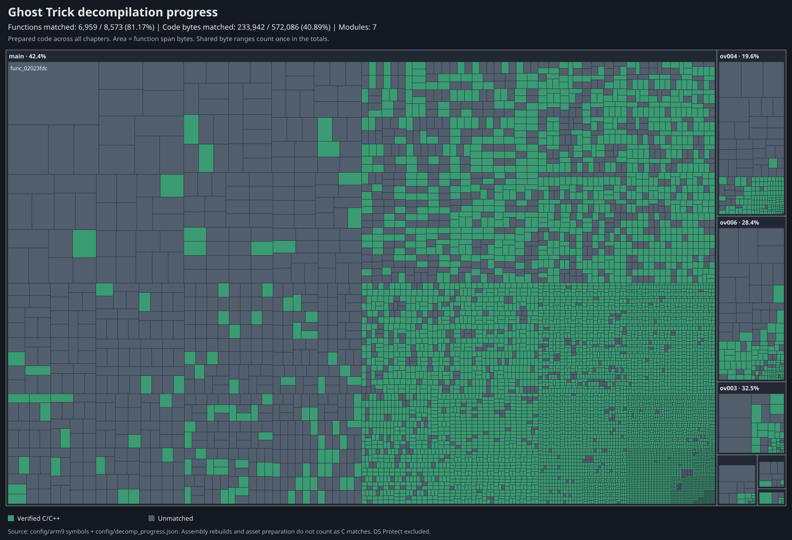

# Ghost Trick Vita

A PS Vita port using the original DS game logic with the 2023 remaster's art and a single-screen interface.

The first target is **a playable Chapter 1 build for on-device feedback**. The remaining game is a stretch goal after that test. All prepared assets, logic and research are retained for later use. See the [Chapter 1 plan](docs/chapter1.md).

The current work is an autonomous function-matching campaign across the full prepared code inventory, with local checkpoint commits. Chapter 1 remains the first playable release target.

## Decompilation progress



Each rectangle is one function, sized by its byte span and grouped by module. Green means reconstructed C/C++ passes the compiler and linked-function byte check; gray means unmatched. Full-game C link integration and Vita execution are separate milestones. Hover a rectangle in the [SVG](docs/progress-treemap.svg) to see its symbol, address, mode, size and status.

This shows the **full prepared code inventory**, not the number of functions required for Chapter 1. The latter still needs runtime dependency tracing. The denominator comes from ds-decomp's current symbol configuration; the older Ghidra export has a different function census. Shared code ranges count once in byte totals. DS Protect is excluded from the Vita target.

All ten DS binary modules already rebuild byte-identically from assembly. That baseline, Ghidra drafts, compiling candidates and asset preparation do not count as C/C++ matches.

Regenerate the chart whenever symbols or verified progress change:

```
python3 -I tools/progress_treemap.py
python3 -I tools/progress_treemap.py --check
```

Verified functions are recorded in [config/decomp_progress.json](config/decomp_progress.json), with module, address, size, source path, source SHA-256 and verification-record SHA-256. Add a function only after checking its address, size, instruction mode and every linked body byte against the reference. A function match alone does not establish recovery of its external data, use by the full-game build, or correct operation on Vita. The generator checks source identity and inventory consistency; it does not rerun the private ROM/compiler verification. Keep generated binaries and detailed ROM-derived evidence under ignored `extracted/`.

## Working on the port

- [Handoff and local setup](HANDOFF.md)
- [Asset inventory and build baseline](docs/inventory.md)
- [DS-to-remaster animation mapping](docs/frame_mapping.md)
- [Decompilation workflow references](docs/decomp_workflow.md)

The decompilation workflow draws on [ds-decomp](https://github.com/AetiasHax/ds-decomp) and the compiler-driven, AI-assisted process in [sm64ds-decomp](https://github.com/tangosdev/sm64ds-decomp). Their game-specific compiler pins and ARM-only matching assumptions are not applied blindly to Ghost Trick's mostly Thumb code.

Build inputs come from the user's own copies. ROMs, extracted assets, proprietary tools and reference footage stay local and gitignored. The current remaster format research must still be checked against the user's Steam copy. The Vita application is not ready for installation yet.
