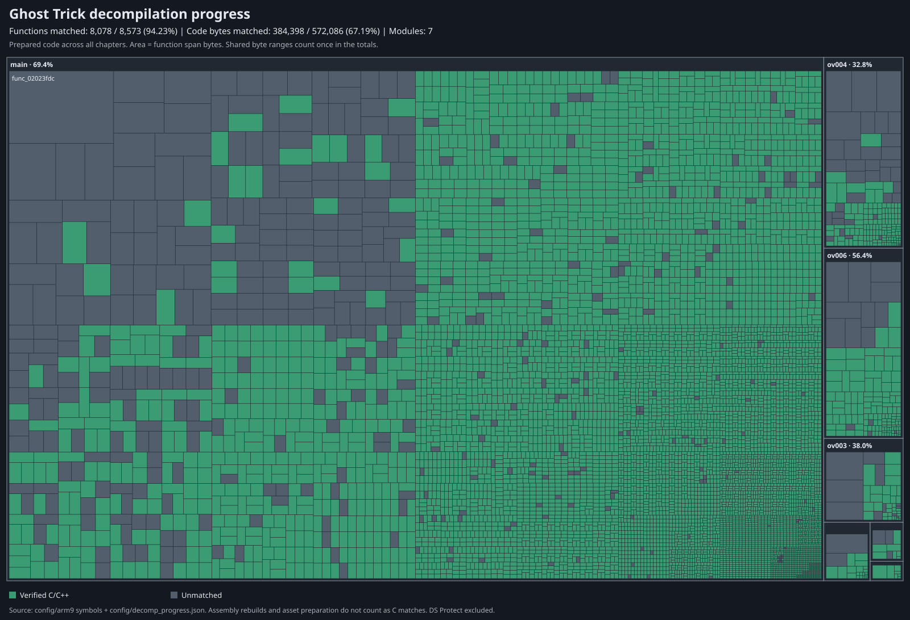

# Ghost Trick Vita

A PS Vita port using the original DS game logic with the 2023 remaster's art and a single-screen interface.

The first target is **a playable Chapter 1 build for on-device feedback**. The remaining game is a stretch goal after that test. All prepared assets, logic and research are retained for later use. See the [Chapter 1 plan](docs/chapter1.md).

The current work is an autonomous function-matching campaign across the full prepared code inventory, with local checkpoint commits. Chapter 1 remains the first playable release target.

## Legal disclaimer

This is an unofficial fan project, not affiliated with or endorsed by Capcom, Nintendo or Sony. *Ghost Trick* belongs to Capcom, and all trademarks belong to their owners.

This repository contains only original work. It contains **no ROM files and no extracted Nintendo or Capcom assets**: no game art, music, sound, text, fonts or script data. Two things in it are worth knowing about:

- `src/` holds C/C++ reconstructed from a study of the DS game's compiled code, along with the symbol and layout data in `config/`. It is not the game's original source code.
- `srcVita/src/third_party/stb_vorbis.c` is an open-source library by its own author, under its own license.

**You must source these files yourself**, from your own legally obtained copy of the game. This project does not provide them or say where to get them. Please don't post game files, or links to them, in this repository.

## Decompilation progress

[](https://liambsulliva.github.io/ghost-trick-vita/)

Each rectangle is one function, sized by its byte span and grouped by module. Green means reconstructed C/C++ passes the compiler and linked-function byte check; gray means unmatched. Full-game C link integration and Vita execution are separate milestones.

Click the preview to open the [interactive treemap](https://liambsulliva.github.io/ghost-trick-vita/), then click a green rectangle to open its verified C/C++ source on GitHub. Gray rectangles have no verified source yet. The README image itself is static; the viewer provides the function links. See [the viewer setup](docs/progress-viewer.md).

This shows the **full prepared code inventory**, not the number of functions required for Chapter 1. The latter still needs runtime dependency tracing. The denominator comes from ds-decomp's current symbol configuration; the older Ghidra export has a different function census. Shared code ranges count once in byte totals. DS Protect is excluded from the Vita target.

All ten DS binary modules already rebuild byte-identically from assembly. That baseline, Ghidra drafts, compiling candidates and asset preparation do not count as C/C++ matches.

Regenerate the chart whenever symbols or verified progress change:

```
python3 -I tools/progress_treemap.py
python3 -I tools/progress_treemap.py --check
```

Verified functions are recorded in [config/decomp_progress.json](config/decomp_progress.json), with module, address, size, source path, source SHA-256 and verification-record SHA-256. Add a function only after checking its address, size, instruction mode and every linked body byte against the reference. A function match alone does not establish recovery of its external data, use by the full-game build, or correct operation on Vita. The generator checks source identity and inventory consistency; it does not rerun the private ROM/compiler verification. Keep generated binaries and detailed ROM-derived evidence under ignored `extracted/`.

## Run it on a Vita

The VPK holds only the app. It has no game data in it, so it also needs art, sound and text converted from your own copy of the remaster's Android release. The app plays Chapter 1 from the DS game's own scripts, with its music, sounds, narration and dialogue. [The app's README](srcVita/README.md#controls) lists the buttons.

You need:

- Python 3, `make`, `clang` and ImageMagick 7 (the `magick` command). The converter draws the game's text with `magick`, which needs FreeType support: `magick -list format | grep OTF` should print a line.
- About 3.6 GB of free disk space for the game files and the converted chapter.
- Your own copy of the remaster's Android release, and your own dump of the USA DS cartridge.
- VitaSDK, to build the VPK. [The app's README](srcVita/README.md#build-and-test) lists its libraries.
- A Vita that can install homebrew with VitaShell.
- The Vita's shader compiler at `ur0:data/libshacccg.suprx`. It does not come with the VPK. Extract it once with ShaRKF00D, if another app has not already made you do this.

The converter steps have been run on macOS only. This project's own testing installs with Vita Companion, so the VitaShell install and FTP copy below are the usual routes, but they have not been tried with this build.

Run every command below from the top of this repository.

### Set everything up with one command

`srcVita/tools/set_up_game.py` does the whole preparation in one go. Give it your copy of the Android package and your own dump of the USA DS cartridge (game code `BGTE`):

```bash
python3 -I srcVita/tools/set_up_game.py --apk "path/to/your-copy.apk" --ds-rom "path/to/your-cartridge.nds"
```

It prints each stage as it starts, with a progress bar while it copies the game files and a running timer with the latest output for the rest:

1. **Check the tools.** `make`, `clang` and `magick` with FreeType support.
2. **Copy the game files out of the Android package.** It takes `re_chunk_000.pak`, `data01` and `data02` (about 3.1 GB) from the package's `assets/` folder into `extracted/remaster_apk/`. They were only tested with Android v1.0.0, packaged as one APK with all three files.
3. **Find the text key.** The narration and speech bubbles are stored encrypted. The key is not in this repository, so it is found in your own package, saved as `extracted/remaster_apk/text_key.bin` and never printed.
4. **Build the converter.**
5. **Convert the art, sound, text and DS scripts** into `extracted/vita_assets/chapter1/` (about 500 MB). The app plays the opening from the DS game's own scripts, so the cartridge dump is required. A cartridge from another region is refused, because no other region's scripts have been checked.
6. **Plan the loading.** It replays the chapter on this computer and writes, for each scene, the list of textures to read ahead and one bundle of its animations.
7. **Build the package**, if VitaSDK is installed. [The app's README](srcVita/README.md#build-and-test) lists its libraries. The package plays the DS soundtrack; add `--arranged-music` to use the remaster's arranged soundtrack instead.
8. **Copy everything to the Vita.** The script tells you what to install and copy, which the next section explains.

Running it again skips what is already done and converts only what changed, so it is also how you update after pulling this repository. Stages 2 and 3 are skipped once their files are in place, so `--apk` is only needed the first time. If a stage fails, the script stops and shows the last lines that stage printed.

Everything under `extracted/` is ignored by git. `tools/rom_audit.py` refuses a file named `text_key.bin` and, when your key file is in place, any file git would track that holds the key as raw bytes, hex or decimal text.

### Copy everything to the Vita

Install `srcVita/build/ghosttrick.vpk` with VitaShell from anywhere under `ux0:`, then copy what is inside `extracted/vita_assets/chapter1/` to `ux0:data/ghosttrick/assets/`. Copy the folder's contents, not the folder itself: a path like `ux0:data/ghosttrick/assets/chapter1/manifest.txt` will not be found.

To copy by hand, put the Vita and this computer on the same Wi-Fi network. In VitaShell, press SELECT to start its FTP server. If SELECT starts USB instead, press START and set **SELECT button** to **FTP**. Then connect an FTP client to the address VitaShell shows.

### Check that it worked

Launch the app. If it was already open, quit it with START first, because it reads the files only when it starts. The screen stays black for about 5 seconds, a `loading` bar shows at the top, and the chapter card appears about 8 seconds after launch.

If you see something else:

| What you see | What is wrong | Look in the log for |
|---|---|---|
| Black or a crash before anything else appears | `ur0:data/libshacccg.suprx` is probably missing | |
| A checker pattern and `no assets in ux0:data/ghosttrick/assets` | `manifest.txt` is missing, misplaced or out of date | `manifest missing`, `manifest invalid` |
| The asset browser instead of the chapter | `scripts/` is missing, because the DS cartridge step did not run | `opening needs_scripts` |
| Magenta blocks | `textures/` is missing or out of date | `texture missing` |
| Rooms with nothing in them | `animations/` is missing or out of date | `animation missing`, `animation invalid` |

The log is `ux0:data/ghosttrick/run.log`. It keeps earlier launches, so read below the last `--- launch` line.

After updating this repository, run the setup script again and copy the files across again. The file formats can change, and older files do not always produce an error: some just play wrongly.

## Changes from the original

The port follows the DS game's own code wherever it can. The changes below are deliberate. They make it play better on the Vita, and they are not in the original:

- **Narration can be hurried.** A CROSS press while Sissel's narration fades in shows the whole page at once, as it does for speech bubbles. The next press moves on, even on pages the original times by itself.
- **The right stick pans the ghost view.** While the player holds the chain, the left stick moves the soul and the right stick pans the camera. The camera stays where it was panned until the soul is aimed again.
- **Vita buttons instead of touch alone.** Every touch action also has a button, and the on-screen prompts show the Vita's buttons rather than the remaster's keyboard keys. [The app's README](srcVita/README.md#controls) lists them.

## Working on the port

- [Handoff and local setup](HANDOFF.md)
- [The Vita app: build, test, run on the device](srcVita/README.md)
- [Asset inventory and build baseline](docs/inventory.md)
- [DS-to-remaster animation mapping](docs/frame_mapping.md)
- [Decompilation workflow references](docs/decomp_workflow.md)

The decompilation workflow draws on [ds-decomp](https://github.com/AetiasHax/ds-decomp) and the compiler-driven, AI-assisted process in [sm64ds-decomp](https://github.com/tangosdev/sm64ds-decomp). Their game-specific compiler pins and ARM-only matching assumptions are not applied blindly to Ghost Trick's mostly Thumb code.

Build inputs come from the user's own copies. ROMs, extracted assets, proprietary tools and reference footage stay local and gitignored. The current remaster format research has not yet been checked against a Steam copy. The Vita app in [srcVita](srcVita/README.md) installs and runs on real hardware, where it plays the opening of Chapter 1 at 60 fps from locally converted remaster art. The DS scripts now run the whole chapter, with player input connected. Most effects are not drawn yet.
